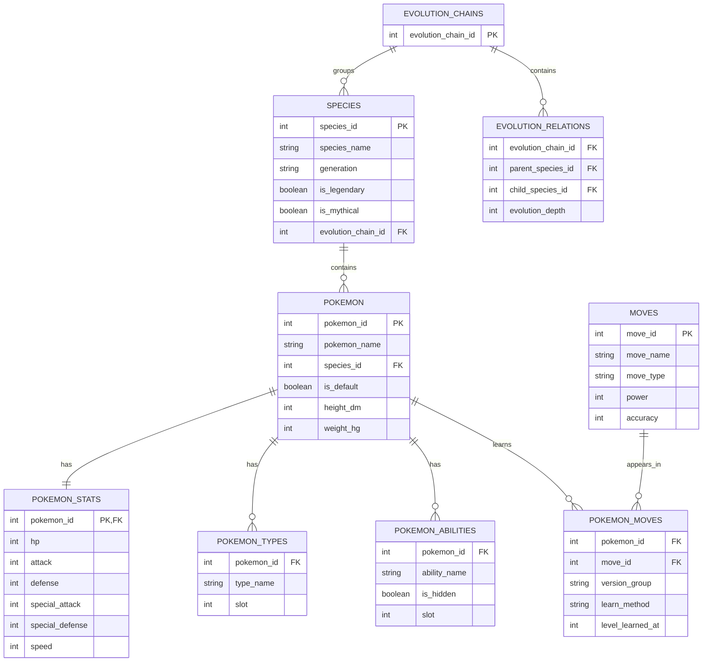

# 03 — Modelo de Datos

## Proyecto: Pokémon Team Recommender

**Fase:** Minería de Datos  
**Estado:** Diseño preliminar  
**Fuente:** PokéAPI v2  
**Arquitectura:** Datos relacionales normalizados → Dataset analítico

---

## 1. Objetivo

Diseñar un modelo conceptual y lógico que permita integrar correctamente la información de Pokémon, especies, estadísticas, tipos, habilidades, movimientos y evoluciones.

El modelo debe garantizar:

- Identificación única de entidades.
- Relaciones consistentes.
- Ausencia de duplicación accidental.
- Separación entre datos originales y derivados.
- Trazabilidad de los recursos.
- Preparación para análisis y Machine Learning.

El diseño será independiente de un motor de base de datos específico.

---

## 2. Enfoque de modelado

El proyecto utilizará dos representaciones complementarias.

### 2.1 Modelo normalizado

Permitirá conservar las entidades y sus relaciones sin multiplicar registros durante las uniones.

Se utilizará durante la ingeniería de datos.

### 2.2 Modelo analítico

Concentrará las características necesarias para análisis, clustering y recomendación.

La granularidad propuesta será:

**Una fila por `pokemon_id`.**

Ambos modelos deberán mantenerse relacionados mediante identificadores consistentes.

---

## 3. Entidades principales

### 3.1 pokemon

Representa una entrada Pokémon con características de combate.

**Clave primaria:** `pokemon_id`

| Campo | Tipo lógico | Restricción |
|---|---|---|
| pokemon_id | INTEGER | PK |
| pokemon_name | STRING | NOT NULL |
| species_id | INTEGER | FK |
| is_default | BOOLEAN | NOT NULL |
| height_dm | INTEGER | NOT NULL |
| weight_hg | INTEGER | NOT NULL |
| base_experience | INTEGER | NULL |

Relación:

Cada entrada Pokémon pertenece a una especie.

Una especie puede estar relacionada con varias entradas Pokémon.

---

### 3.2 species

Representa información propia de la especie.

**Clave primaria:** `species_id`

| Campo | Tipo lógico | Restricción |
|---|---|---|
| species_id | INTEGER | PK |
| species_name | STRING | NOT NULL |
| generation | STRING | NOT NULL |
| is_legendary | BOOLEAN | NOT NULL |
| is_mythical | BOOLEAN | NOT NULL |
| capture_rate | INTEGER | Según disponibilidad |
| habitat | STRING | NULL |
| growth_rate | STRING | Según disponibilidad |
| evolution_chain_id | INTEGER | NULL |

Relaciones:

- Una especie puede tener varias entradas Pokémon.
- Una especie puede pertenecer a una cadena evolutiva.
- Una especie tiene una generación de introducción.

---

### 3.3 pokemon_stats

Contiene las seis estadísticas base de una entrada Pokémon.

**Clave primaria y foránea:** `pokemon_id`

| Campo | Tipo lógico |
|---|---|
| pokemon_id | INTEGER |
| hp | INTEGER |
| attack | INTEGER |
| defense | INTEGER |
| special_attack | INTEGER |
| special_defense | INTEGER |
| speed | INTEGER |

Relación:

`pokemon` 1:1 `pokemon_stats`

Se propone una fila por entrada Pokémon.

---

### 3.4 pokemon_types

Representa los tipos asociados a cada entrada Pokémon.

**Clave compuesta propuesta:** `(pokemon_id, slot)`

| Campo | Tipo lógico |
|---|---|
| pokemon_id | INTEGER |
| type_name | STRING |
| slot | INTEGER |

Relación:

`pokemon` 1:N `pokemon_types`

Un Pokémon puede tener más de un tipo.

Se conservará el orden original mediante `slot`.

---

### 3.5 pokemon_abilities

Representa las habilidades asociadas a cada entrada Pokémon.

**Clave compuesta propuesta:** `(pokemon_id, slot)`

| Campo | Tipo lógico |
|---|---|
| pokemon_id | INTEGER |
| ability_name | STRING |
| is_hidden | BOOLEAN |
| slot | INTEGER |

Relación:

`pokemon` 1:N `pokemon_abilities`

La presencia de una habilidad en esta tabla indica disponibilidad, no que todas las habilidades puedan estar activas simultáneamente.

---

### 3.6 moves

Representa la información general de cada movimiento.

**Clave primaria:** `move_id`

| Campo | Tipo lógico |
|---|---|
| move_id | INTEGER |
| move_name | STRING |
| move_type | STRING |
| power | INTEGER NULL |
| accuracy | INTEGER NULL |
| pp | INTEGER NULL |
| priority | INTEGER |
| damage_class | STRING |

---

### 3.7 pokemon_moves

Representa la relación entre Pokémon y movimientos.

**Clave compuesta propuesta:**

`(pokemon_id, move_id, version_group, learn_method, level_learned_at)`

| Campo | Tipo lógico |
|---|---|
| pokemon_id | INTEGER |
| move_id | INTEGER |
| version_group | STRING |
| learn_method | STRING |
| level_learned_at | INTEGER |

Relación:

`pokemon` N:M `moves`

La relación se resuelve mediante `pokemon_moves`.

Un mismo movimiento puede aparecer en diferentes versiones o métodos de aprendizaje.

---

### 3.8 type_effectiveness

Representa las relaciones de efectividad entre tipos.

**Clave compuesta propuesta:**

`(ruleset_id, attacking_type, defending_type)`

| Campo | Tipo lógico |
|---|---|
| ruleset_id | STRING |
| attacking_type | STRING |
| defending_type | STRING |
| multiplier | FLOAT |

El campo `ruleset_id` permitirá identificar el conjunto de reglas utilizado.

Ejemplos conceptuales:

```text
ruleset_id | attacking_type | defending_type | multiplier
modern     | fire           | grass          | 2.0
modern     | fire           | water          | 0.5
modern     | fire           | fire           | 0.5
```

La etiqueta `modern` es provisional y deberá sustituirse por una definición explícita del conjunto de reglas.

---

### 3.9 evolution_chains

Representa una cadena evolutiva.

**Clave primaria:** `evolution_chain_id`

| Campo | Tipo lógico |
|---|---|
| evolution_chain_id | INTEGER |

---

### 3.10 evolution_relations

Representa relaciones entre especies dentro de una cadena evolutiva.

**Clave compuesta propuesta:**

`(evolution_chain_id, parent_species_id, child_species_id)`

| Campo | Tipo lógico |
|---|---|
| evolution_chain_id | INTEGER |
| parent_species_id | INTEGER |
| child_species_id | INTEGER |
| evolution_depth | INTEGER |

Las cadenas evolutivas pueden contener ramificaciones.

La raíz de una cadena se identificará mediante su asociación con `evolution_chain_id`; no requiere una relación padre-hijo.

---

## 4. Modelo entidad-relación



La tabla `type_effectiveness` se mantiene como una matriz de reglas separada, relacionada conceptualmente con los tipos usados por Pokémon y movimientos.

---

## 5. Cardinalidades

| Relación | Cardinalidad | Justificación |
|---|---|---|
| species → pokemon | 1:N | Una especie puede tener varias variedades |
| pokemon → pokemon_stats | 1:1 | Una entrada tiene un conjunto de estadísticas base |
| pokemon → pokemon_types | 1:N | Puede tener varios tipos |
| pokemon → pokemon_abilities | 1:N | Puede disponer de varias habilidades |
| pokemon → pokemon_moves | 1:N | Puede aprender varios movimientos |
| moves → pokemon_moves | 1:N | Un movimiento puede estar asociado a varios Pokémon |
| evolution_chains → species | 1:N | Una cadena puede agrupar varias especies |
| evolution_chains → evolution_relations | 1:N | Una cadena puede contener varias relaciones |

Las cardinalidades describen el modelo lógico propuesto y se verificarán con los recursos reales.

---

## 6. Reglas de integridad

### Integridad de identificadores

- `pokemon_id` no puede repetirse en `pokemon`.
- `species_id` no puede repetirse en `species`.
- Cada `pokemon.species_id` debe existir en `species`.
- Cada `pokemon_stats.pokemon_id` debe existir en `pokemon`.

### Integridad de estadísticas

- Deben identificarse las seis estadísticas base.
- No deben existir valores negativos.
- No deben duplicarse estadísticas para una misma entrada.

### Integridad de tipos

- Se conservará `slot`.
- No deben existir posiciones duplicadas para un mismo Pokémon.
- Los nombres de tipo deben corresponder al catálogo de tipos seleccionado.

### Integridad de movimientos

- Cada movimiento debe tener identificador válido.
- Se conservará información de disponibilidad por versión.
- No se eliminarán relaciones sin documentar la regla aplicada.

---

## 7. Prevención de duplicados

Las relaciones uno a muchos pueden generar multiplicación de filas durante las uniones.

Ejemplo:

Un Pokémon tiene:

- 2 tipos.
- 3 habilidades.
- 20 movimientos.

Una unión directa de las tres relaciones podría generar:

```text
2 × 3 × 20 = 120 filas
```

Esto no representa 120 Pokémon diferentes.

### Estrategia

1. Mantener las relaciones en tablas separadas.
2. Validar claves primarias y compuestas.
3. Agregar o transformar relaciones antes de unirlas al dataset analítico.
4. Verificar el número de registros antes y después de cada unión.

---

## 8. Dataset analítico

Se propone construir un dataset final con una fila por `pokemon_id`.

### Variables iniciales

```text
pokemon_id
pokemon_name
species_id
species_name
generation
is_default
hp
attack
defense
special_attack
special_defense
speed
height_m
weight_kg
base_experience
is_legendary
is_mythical
```

Posteriormente podrán incorporarse:

```text
total_stats
type_count
weakness_count
resistance_count
immunity_count
physical_bulk_proxy
special_bulk_proxy
cluster_id
profile_name
```

Los campos derivados no deberán confundirse con información original de PokéAPI.

---

## 9. Flujo de transformación propuesto

```text
PokéAPI
   |
   v
JSON Raw
   |
   v
Extracción de entidades
   |
   v
Tablas normalizadas
   |
   v
Validaciones
   |
   v
Integración controlada
   |
   v
Dataset analítico
   |
   +---- EDA
   |
   +---- Feature Engineering
   |
   +---- Clustering
   |
   +---- Recomendación
```

La implementación corresponde a la fase de ingeniería de datos.

---

## 10. Formatos de almacenamiento

Se propone utilizar:

### Raw

Archivos JSON que conserven las respuestas originales.

### Procesados

Archivos CSV o Parquet con esquemas tabulares consistentes.

### Analíticos

Datasets preparados para análisis y Machine Learning.

No se requiere inicialmente implementar una base de datos relacional.

El modelo lógico puede materializarse mediante archivos tabulares.

---

## 11. Decisiones pendientes

Antes de implementar la ingeniería de datos deberán confirmarse:

1. Generaciones incluidas.
2. Variedades elegibles.
3. Formato o reglas de combate.
4. Tratamiento de formas.
5. Campos obligatorios.
6. Manejo de valores faltantes.
7. Esquema físico de almacenamiento.
8. Estrategia de extracción.
9. Validaciones automatizadas.
10. Identificación de versiones de datos.

---

## 12. Criterios de aceptación

- [ ] Entidades identificadas.
- [ ] Claves primarias propuestas.
- [ ] Relaciones documentadas.
- [ ] Cardinalidades verificadas.
- [ ] Unidad de análisis definida.
- [ ] Riesgos de duplicación identificados.
- [ ] Dataset analítico propuesto.
- [ ] Reglas de integridad documentadas.
- [ ] Decisiones pendientes registradas.

---

## 13. Conclusión

El modelo propuesto separa las entidades originales de PokéAPI de la representación analítica que utilizará el proyecto.

Esta separación permitirá conservar relaciones complejas sin generar duplicados y facilitará la construcción de variables para clustering y recomendación.

El modelo será revisado durante la exploración técnica y podrá ajustarse antes de implementar la ingeniería de datos.

---

## 14. Referencias

- PokéAPI v2: https://pokeapi.co/docs/v2
- Pokémon: https://pokeapi.co/docs/v2#pokemon
- Pokémon Species: https://pokeapi.co/docs/v2#pokemon-species
- Types: https://pokeapi.co/docs/v2#types
- Moves: https://pokeapi.co/docs/v2#moves
